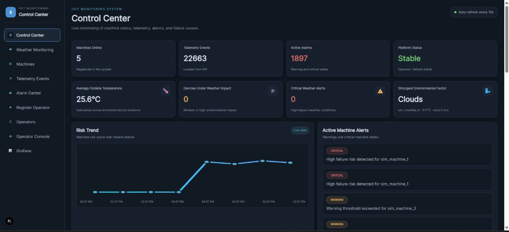
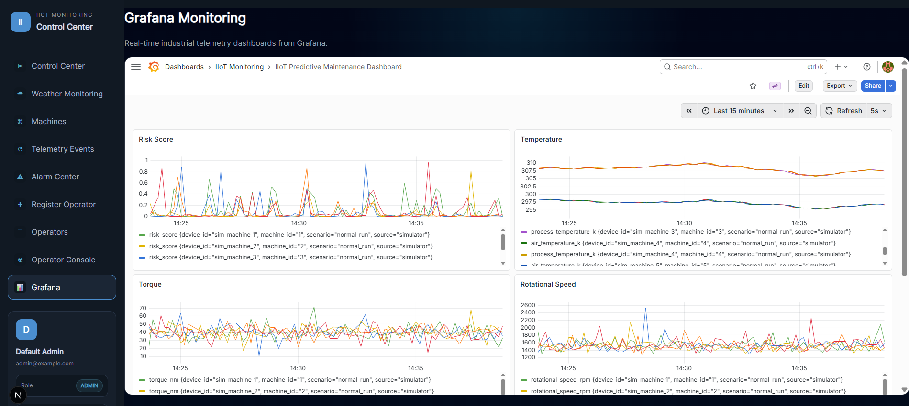
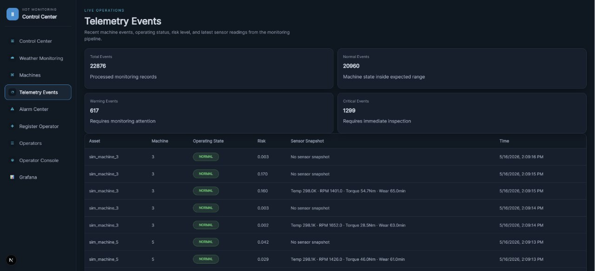
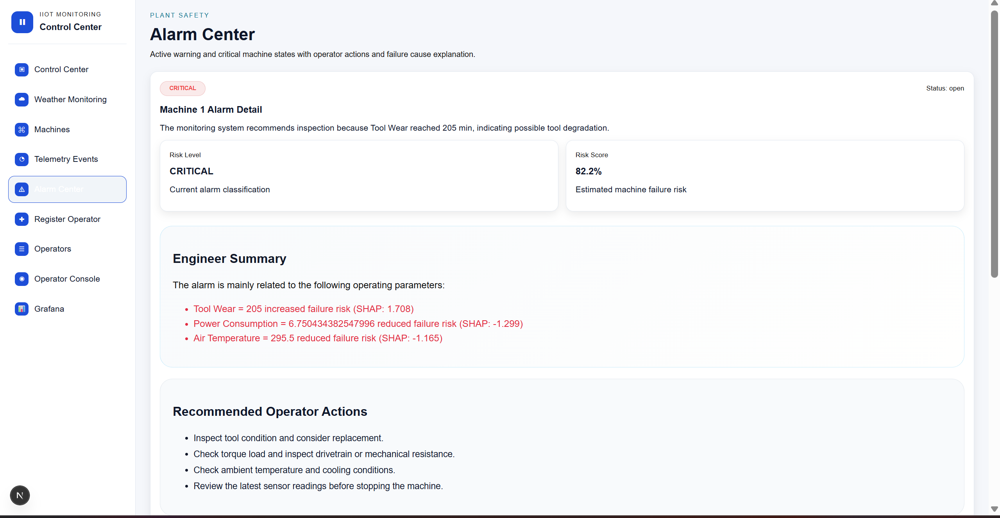
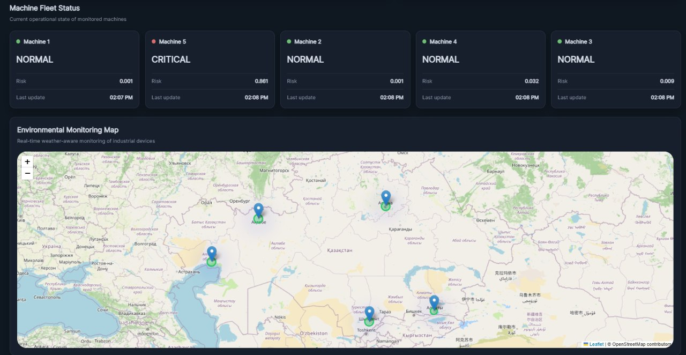
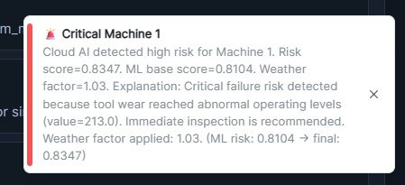

## 📸 Application Screenshots

### 📊 Monitoring Dashboard
Real-time monitoring of industrial IoT devices.

### 📈 Grafana Dashboard
Visualization of system metrics and monitoring data.

### 📡 Device Telemetry
Displaying telemetry data collected from connected devices.

### 🚨 Alarm Details
Viewing detailed information about system alarms.

### 🗺️ Device Map
Geographical visualization of monitored devices.

### 🔔 Alert Notifications
Notification interface for monitoring system events.

